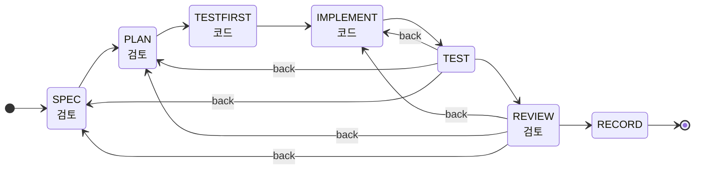
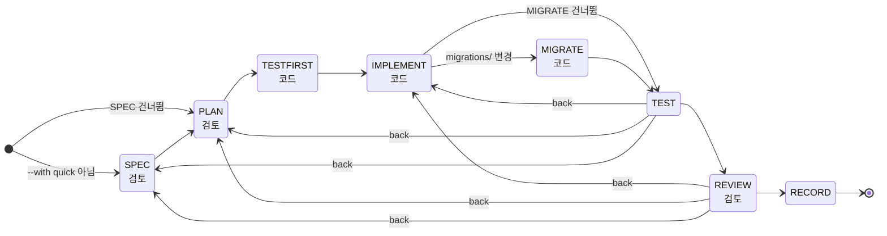

<!-- 문체 점검: GitHub에 공개하는 README -->

# dynamic-stagegate-harness

Claude Code 에이전트의 작업을 단계로 나누고 단계마다 넘어가는 조건을 검사하며, 진행 기록을 근거로 그 단계 구조를 고쳐 가는 하네스 플러그인이다.


각 단계는 state machine의 상태이고, 작업마다 계획 파일 하나와 상태 경로가 있다. 상태마다 할 일과 넘어가는 조건이 있고, 조건은 모델의 판단이 아니라 계획 파일, git 기록, 테스트나 eval 명령, 결과 파일로 검사한다. 상태에 맞지 않는 행동은 Claude Code hook과 git hook이 막는다.

상태 경로는 프로젝트가 자라면서 구조 변경 제안서로 바꿀 수 있다. 제안서는 에이전트가 진행 기록을 진단해 쓰고, lint와 지난 계획 재생과 검토자를 거쳐 사용자가 승인해야 적용된다. 이름은 단계마다 관문을 통과해야 다음으로 넘어가는 Stage-Gate 방식에서 따왔고, 관문 구조가 바뀐다는 뜻으로 dynamic을 붙였다.

## 동작 방식

service preset의 feature 작업은 아래 경로를 지난다. 검토 표시가 있는 상태는 읽기 도구만 쓰는 별도 Claude 호출인 검토자가 PASS를 줘야 넘어가고, 코드 표시가 있는 상태에서만 코드 편집과 커밋이 열린다. 넘어가는 조건을 채우지 못하면 그 상태에 머문다. 앞 상태에서 정한 내용이 틀렸으면 `back` 명령으로 되돌아가는데, 종류마다 적어 둔 경로로만 갈 수 있다.



TESTFIRST는 구현 전에 쓴 테스트가 실패해야 넘어가고, TEST는 그 테스트와 프로젝트 테스트 명령이 통과해야 넘어간다. TEST는 SPEC에서 검토받은 절과 TESTFIRST에서 실패했던 새 테스트 명령이 그 뒤에 바뀌지 않았는지 본다. TESTFIRST에서 쓴 테스트 파일을 그 뒤에 고쳤으면 "테스트 수정" 표에 이유가 적혀 있어야 TEST가 넘어간다. REVIEW의 검토자는 계획을 시작한 뒤의 코드 diff를 받아 계획 파일과 견주고, 고친 테스트가 약해졌는지도 본다. 에이전트가 순서를 건너뛰면 다음처럼 막히고, 막힌 이유와 다음에 할 일을 같이 받는다.

```
# 계획 없이 코드를 고치려 할 때 (PreToolUse hook)
코드를 고치는 상태인 계획이 없어 src/app.py 수정을 막았다. python -X utf8 .gate/gate.py status로
상태를 보고, 계획을 시작하거나 next로 코드 상태까지 진행한다.

# 계획 파일을 채우지 않고 다음 상태로 넘기려 할 때
$ python -X utf8 .gate/gate.py next P001
P001 SPEC에서 넘어가지 못했다. 빠진 것:
  - '요구사항' 절이 비었다
  - '수용 기준' 절 표에 칸이 모두 찬 행이 1개 이상 있어야 한다(지금 0개)
  - '범위 밖' 절이 비었다
```

## 빠른 시작

Python 3.11 이상과 git이 필요하다.

1. 마켓플레이스를 추가한다. 저장소를 받아 둔 경우에는 GitHub 경로 대신 로컬 폴더 경로를 줘도 된다.
   ```
   claude plugin marketplace add taejeong0416/dynamic-stagegate-harness
   ```
2. 플러그인을 설치한다.
   ```
   claude plugin install dynamic-stagegate-harness@dynamic-stagegate-harness
   ```
3. 하네스를 쓸 프로젝트에서 Claude Code를 열고 preset을 골라 설치 skill을 부른다.
   ```
   /dynamic-stagegate-harness:setup service
   ```
4. 이어지는 목적 인터뷰에 답한다. 답은 `.gate/PROFILE.md`에 남고 첫 구조 조정에 쓰인다.

플러그인을 사용자 범위로 설치해도 `.gate/config.toml`이 없는 프로젝트에서는 hook이 아무것도 하지 않는다.

## 주요 기능

- 설치할 때 목적 인터뷰로 프로젝트의 목적, 검증 방법, 작업 종류, 실패 비용을 정하고, 그에 맞춰 preset 구조를 조정한다.
- `gate next`가 넘어가는 조건을 검사하고 조건이 맞는 다음 상태로 계획을 옮긴다. 경로에는 조건을 붙일 수 있어서, 마이그레이션이 바뀐 계획만 MIGRATE에 들르게 하거나 `--with quick`으로 시작한 계획은 SPEC을 건너뛰게 할 수 있다.
- 종류의 `back`에 되돌아가는 경로를 적어 두면 그 경로로만 돌아가고, 경로는 다이어그램과 진단에 하나씩 나온다.
- `unchanged` 검사는 상태를 넘길 때 절 내용을 기록해 두고 뒤 상태에서 그 내용이 바뀌었으면 막는다. 실패했던 테스트 명령이나 검토받은 수용 기준을 나중에 고쳐서 통과하지 못한다.
- `test_edits` 검사는 먼저 쓴 테스트, 재현 테스트, 고정한 eval 케이스, refactor 전의 테스트를 고치거나 지운 계획을 막는다. 고친 파일과 이유를 "테스트 수정" 표에 쓰면 넘어가고, service의 REVIEW 검토자가 그 변경을 다시 본다.
- 실패해야 하는 명령은 테스트를 돌리지 못한 경우를 실패로 치지 않는다. 명령의 프로그램을 찾지 못하거나 종료 코드가 4, 5, 126, 127이면 막는다. 같은 명령과 같은 테스트 파일로 실패를 확인한 기록이 있으면 다시 돌리지 않아서, 구현한 뒤 back으로 TESTFIRST나 REPRO에 돌아와도 넘어갈 수 있다.
- 검토자 지시문에 `{diff}`를 넣으면 계획을 시작한 뒤의 코드 diff를 파일로 받고, 코드가 바뀌면 같은 계획 내용이어도 다시 검토한다. diff 머리에는 "변경 파일" 표에 있는데 바뀌지 않은 파일과 표에 없는데 바뀐 파일이 적힌다.
- 종류에 `limit` 조건을 두면 그 조건을 벗어난 계획은 커밋과 `next`가 막힌다. service와 agent의 chore는 계획에 적은 코드 파일이 5개를 넘으면 다른 종류로 다시 시작해야 한다.
- service의 chore는 `[project] affected` 명령이 통과해야 끝난다. affected에는 `npx vitest related --run {files}`처럼 계획의 코드 파일과 관련된 테스트만 돌리는 명령을 넣고, 비어 있으면 전체 테스트 명령을 쓴다.
- 코드 상태인 계획이 없으면 코드 편집을 막고, 계획의 "변경 파일" 표에 없는 코드 파일은 커밋을 막는다. 구조 파일인 config.toml, history, gatekit과 git hook을 직접 편집하는 것도 막는다.
- 이 세션이 고친 코드나 하네스 파일에 커밋하지 않은 변경이 있거나, 이번 턴에 다룬 계획이 멈추면 안 되는 상태에 있으면 턴을 끝내지 못하게 한다. 일반 질문이나 부가 작업 턴, 다른 세션의 작업으로는 막지 않는다.
- SessionStart hook이 진행 중인 계획과 할 일을 컨텍스트에 넣고, 메시지마다 계획 목록이 한 줄씩 들어간다. 컨텍스트가 압축돼도 상태는 파일에 남아 있어서 다시 들어온다.
- `gate describe --mermaid`가 지금 구조의 경로를 위와 같은 다이어그램으로 출력한다.

## preset

| preset | 쓰는 곳 | 종류와 상태 경로 |
|---|---|---|
| ml | 대회, 연구 실험 | new와 model(RESEARCH부터 REPLAN까지 8개), tune, freeze, repro, eda, infra. 프로젝트 단계별로 허용 종류를 제한하고, 서버 실행은 커밋과 예상 종료 시각 기록 뒤에만 연다 |
| agent | LLM 에이전트, 프롬프트, 도구 | behavior(SPEC, EVALSET, IMPLEMENT, EVAL, RECORD, REPLAN), prompt, bugfix, chore. eval 케이스를 구현 전에 커밋하고, 결과 파일이 새로 만들어져야 넘어간다. 고정한 케이스를 고치면 이유를 적어야 한다 |
| service | 웹 서비스, 앱, 라이브러리, CLI | feature(SPEC, PLAN, TESTFIRST, IMPLEMENT, TEST, REVIEW, RECORD), bugfix(재현 명령이 REPRO에서 실패하고 FIX에서 통과), refactor, chore. chore를 뺀 종류는 REVIEW에서 코드 diff를 검토받는다 |

고른 preset은 처음 구조로 쓰인다. 설치하면 세 preset의 구조가 `.gate/library/`에 같이 들어가서, 구조를 바꿀 때 다른 preset의 상태와 절을 빌려 쓴다.

## 구조 진화

구조는 제안서로만 바꾼다. SessionStart hook은 마지막 구조 변경 뒤 끝난 계획 수나 hook이 막은 횟수가 기준을 넘으면 점검을 권한다.

1. `gate diagnose`가 상태별로 들어온 횟수, back, 건너뜀, 머문 시간, 절 글자 수, 검토 FAIL 이유와 되돌아간 경로별 횟수를 모으고, hook이 막은 기록과 저장소 변화도 모은다.
2. 에이전트가 그 수치를 근거로 `.gate/proposals/H###.md`에 제안서를 쓴다. 상태나 검사를 더하는 변경은 근거 하나로 충분하고, 빼거나 약하게 하는 변경은 진단 수치가 있어야 한다.
3. `gate check-proposal`이 lint, 지난 계획 재생, diff, 새 경로 다이어그램을 진단 파일에 쓰고 검토자를 부른다.
4. 사용자가 바꾸는 것과 근거를 보고 승인하면 `gate adopt`가 적용한다. guard hook은 승인 문장이 이번 턴 사용자 입력에 있는지 확인한다.

앞 구조는 `.gate/history/`에 남고, 진행 중인 계획은 시작할 때의 구조 버전을 끝까지 쓴다. 아래는 마이그레이션 단계와 작은 작업용 선택을 더한 뒤의 feature 경로 예시다.



## 넘어가는 조건

구조는 프로젝트의 `.gate/config.toml`에 있고, 키 설명과 명령은 GATE.md에 있다. 상태마다 아래 검사를 골라 붙이며, 검사마다 `only = [종류]`나 `skip = [종류]`로 적용할 종류를 고른다.

| 검사 | 통과 조건 |
|---|---|
| filled | 절이 비어 있지 않다. items를 주면 그 bullet 항목마다 값이 있다 |
| table | 절의 표에 칸이 모두 찬 행이 min_rows개 이상 있다 |
| files_listed | "변경 파일" 절에 code 패턴에 맞는 파일이 있다 |
| files_changed | 이 상태에 처음 들어온 뒤의 커밋에서 그 파일이 바뀌었다(any = true면 하나 이상) |
| clean | 코드에 커밋하지 않은 변경이 없다 |
| numbers | 코드에 새로 넣은 숫자(0과 1 제외)가 근거 표 첫 칸에 있다 |
| sample | 표본 실행 절의 커밋이 코드 파일을 마지막으로 바꾼 커밋이다 |
| results | 이 상태에 들어온 뒤에 결과 파일이 만들어졌다([remote]가 있으면 서버도 본다) |
| command | 명령이 통과한다. use = "test"나 "affected"면 [project]의 그 명령을 쓰고, expect = "fail"이면 테스트가 돌고 실패해야 한다 |
| run_record | `gate run` 기록이 있다 |
| commit_since | 이 상태에 들어온 뒤 path를 바꾼 커밋이 있다(mention = true면 계획 번호를 쓴 줄) |
| choice | 고른 갈래가 결과별 다음 행동 표의 첫 칸 하나이거나 escape 문구다 |
| refs | 절에서 pattern에 맞는 참조가 file에 모두 있다 |
| paths_exist | 절에 적은 파일 경로가 모두 있다 |
| reviewed | state에서 받은 검토 뒤 계획 내용이 바뀌지 않았다 |
| unchanged | state를 넘긴 뒤 그 상태가 쓰는 절이 바뀌지 않았다(sections로 절을, section과 items로 bullet 항목을 고른다) |
| test_edits | state를 처음 넘긴 뒤 고치거나 지운 테스트 파일이 section 표에 있다. state가 없으면 계획을 시작한 뒤를 본다 |

## 비슷한 접근과 차이

LLM 작업을 state machine이나 그래프로 나누는 방법은 이미 여럿 있는데, 이 하네스는 에이전트 런타임을 새로 만들지 않은 채 Claude Code 바깥에서 관문을 검사한다.

| 접근 | 하는 일 | 이 하네스와 다른 점 |
|---|---|---|
| StateFlow(2024 논문) | LLM 작업을 상태와 전이로 나누고, 상태마다 프롬프트와 도구를 정한다 | 같은 분해를 쓰되, 전이 조건을 모델이 아니라 파일, git, 명령 결과로 검사한다 |
| LangGraph | 노드와 간선으로 에이전트를 구성하고 상태를 체크포인트로 남긴다 | 자체 런타임이 아니라 Claude Code hook과 git hook 위에서 돈다. 경로는 조건부로 건너뛰는 선형 경로와 적어 둔 되돌아가는 경로로 제한해 lint와 재생이 가능하게 했다 |
| TDD Guard, Probity | hook으로 에이전트의 파일 쓰기와 명령을 규칙에 따라 막는다 | 테스트 상태 하나가 아니라 명세, 계획, 구현, 기록으로 이어지는 작업 단계 전체를 보고 막을 행동을 정한다. 같은 편집이 IMPLEMENT에서는 열리고 SPEC에서는 막힌다 |
| Superpowers, Spec Kit | skill과 템플릿으로 설계, 계획, 구현, 검토 절차를 안내한다 | 절차를 따르는지를 모델에 맡기지 않고, 상태를 넘길 때마다 검사한다 |
| Anthropic의 장시간 에이전트 하네스 | 기능 목록과 진행 파일로 여러 세션의 작업을 잇는다 | 상태 파일을 gate 명령만 쓰게 해서 세션이 바뀌어도 진행 상태가 깨지지 않는 점은 같다. 여기에 구조 자체를 바꾸는 절차를 더했다 |

## 폴더 구조

```
.claude-plugin/marketplace.json      로컬 마켓플레이스
plugins/dynamic-stagegate-harness/
  .claude-plugin/plugin.json
  hooks/hooks.json, run.py            설정이 있는 프로젝트에서만 그 프로젝트의 엔진을 부른다
  gatekit/                            엔진(설치하면 프로젝트의 .gate/gatekit/로 복사된다)
    core.py      설정과 구조 버전, 조건부 경로, 상태 파일, 계획 파일 파싱, git
    checks.py    넘어가는 조건 검사 함수와 검토자 호출
    evolve.py    lint, describe, diagnose, 제안서 검사, adopt
    cli.py       gate 명령과 git hook 검사
    hooks.py     guard, stop, 주입 hook
  presets/ml, agent, service/         config.toml(종류, 상태, 절 정의)
  GATE.md                             프로젝트에 복사되는 명령과 원칙 설명
  scripts/install.py                  설치와 엔진 갱신
  skills/setup, gate, evolve/         설치와 목적 인터뷰, 운영, 구조 다시 짜기
tests/test_gate.py                    임시 저장소에 설치해 명령과 hook을 돌려 보는 테스트
```

테스트는 저장소 루트에서 `python -X utf8 -m unittest discover tests`로 돌린다.

설치한 프로젝트의 `.gate/`에는 config.toml(지금 구조), history/(앞 구조 버전), library/(빌려 쓸 구조), proposals/(제안서와 진단), PROFILE.md(목적), state.json(계획 상태), GATE.md가 들어간다.

엔진을 프로젝트에 복사하면 엔진 버전이 프로젝트 git에 같이 남아서 나중에 다시 실행해도 같은 규칙이 적용된다. 플러그인을 갱신한 뒤에는 `/dynamic-stagegate-harness:setup update`로 엔진만 바꾸고 `harness:` 커밋으로 남긴다.

## 한계

- Claude Code 전용이다. 엔진과 git hook은 에이전트와 관계없이 돌지만, 편집 차단과 턴 종료 검사는 Claude Code의 hook 형식과 대화 기록 형식에 맞춰져 있다.
- 셸 명령 검사는 리다이렉트, tee, sed -i, cp, mv 같은 흔한 우회만 막고, 그 밖의 방법으로 쓴 코드는 커밋 시점의 pre-commit이 잡는다. 구조 파일을 Python 스크립트로 직접 쓰면 guard가 보지 못하고, commit-msg hook이 `harness:` 커밋으로 따로 남기게 할 뿐이다.
- stop hook은 이 세션이 편집 도구로 고친 파일만 본다. 셸 명령이나 스크립트로 고친 파일은 pre-commit과 `clean` 검사가 잡는다.
- 숫자 검사는 .py만 tokenize로 정확히 보고, 다른 언어는 문자열과 주석을 지운 뒤 정규식으로 본다.
- 진단 수치는 판단 자료이고, 상태를 빼거나 더할지는 에이전트의 제안과 사용자 승인으로 정한다.

## 라이선스

MIT 라이선스로 배포한다. 전문은 LICENSE 파일에 있다.

## 참고 자료

- StateFlow: Enhancing LLM Task-Solving through State-Driven Workflows (Wu 외, 2024) https://arxiv.org/abs/2403.11322
- LangGraph https://github.com/langchain-ai/langgraph
- TDD Guard https://github.com/nizos/tdd-guard
- Probity https://github.com/nizos/probity
- Superpowers https://github.com/obra/superpowers
- Spec Kit https://github.com/github/spec-kit
- Effective harnesses for long-running agents (Anthropic) https://www.anthropic.com/engineering/effective-harnesses-for-long-running-agents
- Claude Code hooks https://code.claude.com/docs/en/hooks
